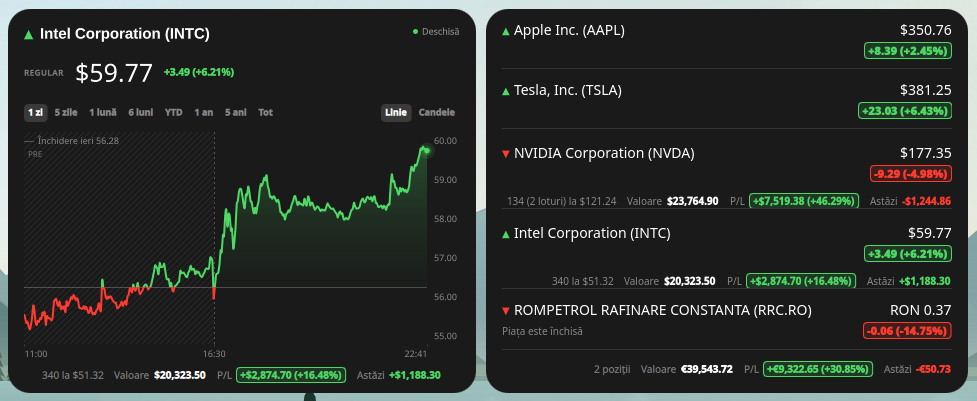

# Plasma Stock Monitor for KDE Plasma 6

Plasma Stock Monitor is a clean, modern stock market widget for KDE Plasma 6. It pulls data directly from Yahoo Finance, covering stocks, crypto, and currencies worldwide.

> **Fork notice:** Plasma Stock Monitor is a fork of [Stock Monitor](https://github.com/vpsone/stock-monitor-widget) by [vps (vpsone)](https://github.com/vpsone), with UI contributions by [Cenk Tekin](https://github.com/cenktekin). See [Credits](#credits) for full attribution.

<p align="center">
    <a href="https://www.pling.com/p/2332661/">
        
    </a>
    <a href="https://ko-fi.com/vsh07">
        
    </a>
</p>



## ✨ Latest Enhancements

- **Modern Badge UI:** Redesigned compact panel view with sleek, semi-transparent percentage badges for better readability.
- **Custom Gain/Loss Colors:** Added a built-in **Color Picker** in settings to customize gain and loss colors.
- **Improved Data Precision:** Enhanced price display with 2-decimal accuracy and integrated change percentages.
- **High Visibility:** Forced theme-independent colors to ensure visibility on all desktop backgrounds.

## 🚀 Features

- **Two Display Modes:** Single View and Multi-Stock List.
- **Two chart styles:** a reference-line chart split at the session open (green above, red below), or candlesticks with a volume strip. Both use a price scale on the right and a time scale underneath; the style is selected in **Appearance → Chart**.
- **Data Ranges:** View history from 1 Day (1D) up to 5 Years (5Y) or Max. Time-scale labels adapt to the selected range (hours, days, months or years), and the range can optionally be switched from buttons directly in the chart without reloading the multi-stock list.
- **Hover details:** move the mouse over either chart to show a crosshair and a tooltip with the timestamp and price (reference chart) or OHLC and volume (candlestick chart).
- **Smart & Efficient:**
  - **Session-open reference:** the reference-line chart marks the price at which the latest session opened.
  - **Market status:** Shows when a market is closed, including indices and symbols without pre-market/after-hours quotes.
  - **Closed-market quotes:** Keeps the last pre-market/after-hours quote visible after the session ends (on by default).
  - **Battery Saver:** Option to stop updating when the market is closed.
  - Weekend detection logic.
- **Backup and restore:** Export the portfolio, watchlist and settings to a JSON file and import them back.
- **Localized:** The whole interface is translatable through gettext/Ki18n and ships with a complete Romanian translation. Any other language can be added without touching the code — see [Localization](#-localization).

<br>

## 🔍 How to Find Ticker Symbols

This widget pulls data directly from **Yahoo Finance**, so you need to use the exact ticker symbol listed on their website.

1.  Go to **[finance.yahoo.com](https://finance.yahoo.com)**.
2.  Search for the company, crypto, or index you want (e.g., "Bitcoin", "Apple").
3.  Copy the symbol shown in parentheses next to the name.

**Examples:**

- **US Stocks:** `AAPL`, `TSLA`, `MSFT`
- **Cryptocurrency:** `BTC-USD`, `ETH-USD`, `DOGE-USD`
- **Indices:** `^NSEI` (Nifty 50), `^GSPC` (S&P 500)
- **Currencies:** `INR=X` (USD/INR), `EURUSD=X`

<br>

## ⚙️ Configuration Options

You can right-click the widget and hit **"Configure..."** to tweak almost everything. Here is what you can change:

### 1\. General Settings

- **Display Mode:** Toggle between showing one big stock or a list of many.
- **Single Ticker:** If you are in Single Mode, type the symbol here (e.g., `AAPL`, `BTC-USD`, `GOOG`).
- **Ticker List:** If you are in Multi-Mode, enter a comma-separated list here (e.g., `TSLA, MSFT, GOOG`).
- **Data Range:** Choose the data range for stocks (`1D`, `5D`, `1M`, `6M`, `YTD`, `1Y`, `5Y`, `Max`).
- **Chart Style:** Choose between the reference-line chart and the candlestick + volume chart. Both show prices on the right and time at the bottom.

### 2\. Updates & Interval

- **Refresh Interval:** How often the data updates (in Minutes). Default is 5 minutes.

### 3\. Active Hours (Battery Saver)

- **Only update during market hours:** Check this to prevent the widget from waking up your network when the stock market is closed.
- **Market Open/Close:** Set the start and end time (e.g., 09:15 to 15:30) matching your local stock exchange time.

### 4\. Import / Export

Open **Configure... → Import / Export** to save or restore a JSON backup. Choose one of three scopes:

- **Portfolio and watchlist:** Holdings, purchase lots, portfolio currency/mode, single ticker and ticker list.
- **Application settings:** Refresh interval, market hours, appearance, panel and display preferences.
- **Everything:** A full backup of the portfolio, watchlist and all settings.

**Export to File...** opens a save dialog; **Import from File...** reads a backup and stages its values. Imported values are applied like any other setting, so press **Apply** or **OK** to keep them, or **Cancel** to discard them. Cached exchange rates are not part of a backup because they are downloaded again automatically.

The backup uses a small helper script (`contents/code/backup-io.sh`) through Plasma's compatibility data engine, so the widget does not need a compiled plugin. If the optional `Plasma5Support` module is not installed, the page explains that file access is unavailable.


## 📦 How to Install

This fork is not published on the KDE Store yet. Install it from source:

```bash
git clone https://github.com/Steinhagen/plasma-stock-monitor.git
cd plasma-stock-monitor
kpackagetool6 --type Plasma/Applet --install .
```

Then right-click the desktop or panel, choose **Add Widgets**, and search for **Plasma Stock Monitor**.

When updating an existing installation, use `--upgrade` instead of `--install`.

## 🌍 Localization

The widget uses KDE's [Ki18n](https://api.kde.org/ki18n-index.html) (gettext), so every label, tooltip and message can be translated. A complete **Romanian** translation is included and is used automatically when the system or Plasma language is Romanian; with any other language the widget falls back to English.

- All user-visible text is wrapped in `i18n()`, `i18nc()` or `i18np()`.
- The catalogs live in [`translate/`](translate/README.md): `template.pot` is the source of truth, `<language>.po` holds the translations and `contents/locale/<language>/LC_MESSAGES/` the compiled `.mo` files Plasma loads.
- To add a language, copy `translate/template.pot` to `translate/<language>.po`, translate it, run `./translate/build.sh` and add `Name[<language>]` / `Description[<language>]` to `metadata.json`.
- After changing the sources, run `./translate/merge.sh && ./translate/build.sh` to refresh the template and rebuild the catalogs.

Full instructions, including plural forms and contexts, are in [translate/README.md](translate/README.md).

## Credits

Plasma Stock Monitor is a fork of [Stock Monitor](https://github.com/vpsone/stock-monitor-widget).

- **Original project:** [Stock Monitor](https://github.com/vpsone/stock-monitor-widget) by [vps (vpsone)](https://github.com/vpsone).
- **UI contributions:** [Cenk Tekin](https://github.com/cenktekin) — modern badge UI, custom gain/loss color picker, and improved price precision.
- **Original KDE Store listing:** [Stock Monitor on the KDE Store](https://store.kde.org/p/2332661/).
- **Upstream contributors:** [contributors to the original project](https://github.com/vpsone/stock-monitor-widget/graphs/contributors).
- **License:** GPL-3.0-or-later, inherited from the original project. Copyright remains with the original authors and contributors.
- **Fork:** [Steinhagen/plasma-stock-monitor](https://github.com/Steinhagen/plasma-stock-monitor), maintained by [Viorel-Cătălin Răpițeanu (Steinhagen)](https://github.com/Steinhagen).

This fork is independent and is not affiliated with or endorsed by the original authors. The KDE Store listing above belongs to the original project; this fork has no KDE Store release yet. Please report fork-specific issues in this repository rather than upstream.
