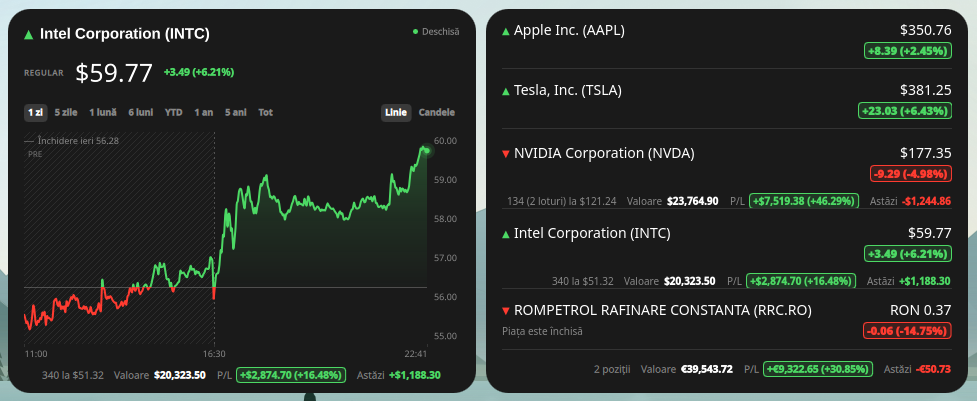

# Plasma Stock Monitor

> **This project has moved.** Plasma Stock Monitor is now **[Market Monitor](https://github.com/Steinhagen/market-monitor-widget)**. This repository is no longer maintained; development continues in the new project, including fixes, new features and releases.
>
> - **New home:** <https://github.com/Steinhagen/market-monitor-widget>
> - **KDE Store:** <https://store.kde.org/p/2381891/>
> - **Migrating:** Market Monitor has a new applet id, so the widget has to be added again and your data carried over with a JSON backup. See [Migrating to Market Monitor](#migrating-to-market-monitor).
>
> The sections below are kept for historical reference only: the installation steps still install the unmaintained widget under the old name.

A clean stock, crypto and currency widget for **KDE Plasma 6**, powered by Yahoo Finance.



## Features

- **Two display modes:** a single-stock view or a multi-stock list, including a side-by-side layout.
- **Symbol display:** show the full Yahoo Finance symbol, the base symbol, or the base symbol with a short exchange badge (`BRD · BVB`) in the list, single-stock header and tooltip; the panel indicator keeps the symbol without the badge.
- **Charts:** reference-line or candlestick, with an optional trading-volume strip for either style, ranges from 1D to Max and optional in-chart range buttons.
- **Analyst price targets (optional):** small green/red triangles just above the chart's price/volume separator line for analyst target raises/lowers, with neutral markers for maintained and newly announced targets. Click a marker for the firm, rating and exact target. Off by default on the **Chart & News** page.
- **News (optional):** the latest headlines from the selected sources — Yahoo Finance, Google (a web search by company name) and BVB (the latter for symbols ending in `.RO`), all on by default — switched with the chart/news icons next to the market status in the single-stock view. The sources, the number of headlines per source and the update interval are configured on the **Chart & News** page; source buttons filter the list by provider when more than one is available.
- **Live context:** pre-market and after-hours quotes, market status, and the last extended quote kept after close.
- **Portfolio:** track purchase lots, profit/loss and multiple currencies.
- **Appearance:** Application and Plasma presets; Application supports Light/Dark/System colors, while Plasma follows the system theme, plus a transparent panel indicator, custom gain/loss colors and opacity.
- **Smart updates:** configurable refresh interval, market-hours-only updates and weekend skipping, plus a quick retry after a failed request at startup.
- **Stale fallback:** the last successful quotes are shown at launch (marked as cached, with their timestamp) while the first request is in flight, so a missing network does not leave the widget empty.
- **Backup:** export and import the portfolio, watchlist and settings as JSON.
- **Localized:** gettext/Ki18n support with a complete Romanian translation included.

## Installation (historical)

### KDE Store

Install **Plasma Stock Monitor** from the [KDE Store](https://store.kde.org/p/2381512/).

You can also open **Add Widgets → Get New Widgets → Download New Plasma Widgets** on your desktop or panel and search for **Plasma Stock Monitor**.

### From source

```bash
git clone https://github.com/Steinhagen/plasma-stock-monitor.git
cd plasma-stock-monitor
kpackagetool6 --type Plasma/Applet --install .
```

Then right-click the desktop or panel, choose **Add Widgets**, and search for **Plasma Stock Monitor**.

To update an existing source installation, use `--upgrade` instead of `--install`.

## Migrating to Market Monitor

[Market Monitor](https://github.com/Steinhagen/market-monitor-widget) continues this widget under a new name and a new applet id (`io.github.steinhagen.marketmonitor`). Widgets already placed on a desktop or panel are not migrated automatically, so switch over once:

1. Install **Market Monitor** from the [KDE Store](https://store.kde.org/p/2381891/) or [from source](https://github.com/Steinhagen/market-monitor-widget#from-source).
2. In the old widget, open **Configure...** and export a JSON backup of your watchlist, portfolio and settings.
3. Add **Market Monitor** to your desktop or panel and import that backup.
4. Remove the old **Plasma Stock Monitor** widget once everything looks right.

Backups exported by the old widget import into Market Monitor. Settings stored under the old applet id are not carried over, which is why the backup round-trip is the way to keep your data.

## Configuration

Right-click the widget and choose **Configure...** to change the display mode, tickers, chart style, refresh interval, theme, colors and portfolio holdings. New widgets start with the **Plasma** preset, which follows the system theme; the Appearance page lets you switch to the widget's own Application cards and choose their Light/Dark/System colors. The same dialog can export or import a JSON backup of your data and settings.

Ticker symbols must match [Yahoo Finance](https://finance.yahoo.com). For example:

| Type | Examples |
| --- | --- |
| US stocks | `AAPL`, `TSLA`, `MSFT` |
| Crypto | `BTC-USD`, `ETH-USD` |
| Indices | `^GSPC`, `^NSEI` |
| Currencies | `EURUSD=X`, `INR=X` |

## Localization

All user-visible text is translatable through Ki18n, and a Romanian translation ships with the widget. To add another language, see [translate/README.md](translate/README.md).

## Development

The test harness runs the QML unit and controller tests with `qmltestrunner`, offline:

```bash
./tests/run.sh
```

It needs the Qt 6 declarative tools (`qmltestrunner`); see [tests/README.md](tests/README.md). The architecture and the refactoring plan live in [docs/architecture.md](docs/architecture.md).

## Credits

Plasma Stock Monitor is a fork of [Stock Monitor](https://github.com/vpsone/stock-monitor-widget) by [vps (vpsone)](https://github.com/vpsone), with UI contributions by [Cenk Tekin](https://github.com/cenktekin) (badge UI, gain/loss color picker and price precision). The fork is maintained by [Viorel-Cătălin Răpițeanu (Steinhagen)](https://github.com/Steinhagen).

Parts of this fork were developed with the assistance of AI coding tools.

This fork is independent and is not affiliated with or endorsed by the original authors.

**License:** GPL-3.0-or-later. Copyright remains with the original authors and contributors.
